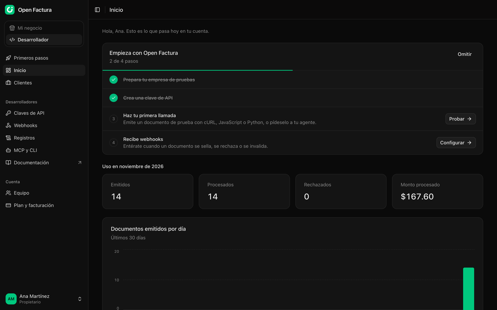
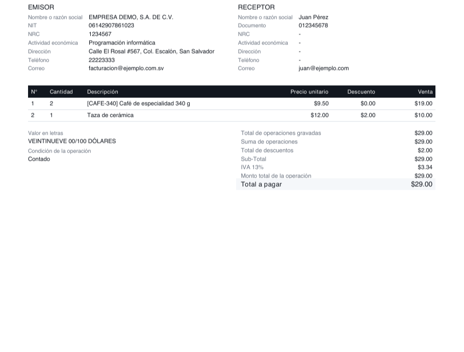
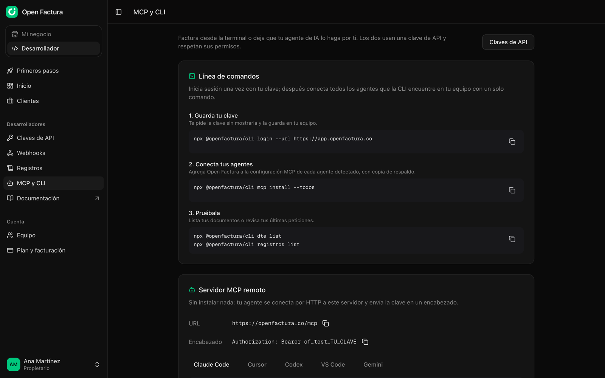

<p align="center">
  
</p>

<h1 align="center">Open Factura</h1>

<p align="center">
  <strong>Facturación electrónica de El Salvador, para desarrolladores.</strong><br>
  Emite DTE ante Hacienda con una sola API: desde tu código, tu terminal o tu agente de IA.
</p>

<p align="center">
  <a href="https://openfactura.co">Sitio</a> ·
  <a href="https://docs.openfactura.co">Documentación</a> ·
  <a href="https://app.openfactura.co/auth/registro">Crea tu cuenta en Open Factura Cloud</a>
</p>

<p align="center">
  
  
  
</p>



Open Factura emite los documentos tributarios electrónicos de El Salvador (DTE, Normativa 2.0): los
construye, los firma y los transmite al Ministerio de Hacienda (MH), resuelve la contingencia y la
invalidación, y genera el PDF. Este repositorio es el núcleo abierto: la API, el servidor MCP, la CLI,
los SDK y las habilidades para agentes. Despliégalo en tu propia cuenta de Cloudflare, o usa
[Open Factura Cloud](https://openfactura.co), que corre esta misma API y suma el panel, la facturación
por WhatsApp y la certificación guiada ante Hacienda.

> **Probado en la realidad.** YA TECHNOLOGIES, S.A. DE C.V., la empresa que opera Open Factura Cloud,
> fue autorizada como emisora de DTE por la DGII (MH.DGII.DFE/008.071632/2026) tras pasar las pruebas
> de Hacienda emitiendo con Open Factura. La autorización es para el emisor; no es una certificación
> del software por parte del Ministerio de Hacienda.

## Qué hace

- **Una API, tres entradas.** Todo funciona desde la API REST, desde tu agente de IA con el servidor
  MCP y desde la terminal con la CLI, con los mismos permisos y límites. La clave de API decide qué
  puede hacer un agente: con una clave `of_test_…` no puede tocar producción.
- **Todos los documentos que pide Hacienda.** Constructores para 11 tipos de DTE: Factura (01),
  Crédito Fiscal (03), Nota de Remisión (04), Nota de Crédito (05), Nota de Débito (06), Comprobante
  de Retención (07), Comprobante de Liquidación (08), Documento Contable de Liquidación (09), Factura
  de Exportación (11), Sujeto Excluido (14) y Comprobante de Donación (15). Más los eventos de
  invalidación, contingencia, retorno y operaciones especiales.
- **Los impuestos, calculados.** Envías ítems y precios; el SDK calcula el IVA, los totales y el valor
  en letras, y valida el resultado contra los esquemas JSON oficiales del MH antes de firmarlo.
- **Firma y transmisión.** Firma JWS RS512 con el certificado del emisor, autenticación y recepción
  ante el MH, y el sello de recepción (`selloRecibido`) guardado con cada documento.
- **Contingencia resuelta.** Si el MH no responde, el documento se firma en contingencia y el servidor
  reintenta solo; la contingencia es un estado, no un error.
- **Nunca se emite dos veces.** `Idempotency-Key` en cada emisión y números de control reservados de
  forma atómica: un reintento o una carrera no salta ni repite un número.
- **Webhooks firmados.** `dte.procesado`, `dte.rechazado`, `dte.contingencia`, `dte.invalidado` y sus
  equivalentes para eventos, cada uno con firma HMAC para verificar.
- **Un PDF que cumple.** La representación gráfica con el código QR a la consulta pública de Hacienda,
  lista para enviar o imprimir.
- **Pruebas sin trámites.** Un simulador del MH incluido emite en el ambiente de pruebas sin
  credenciales, para que integres antes de que Hacienda te autorice.
- **Secretos protegidos.** La contraseña de API del MH y la llave privada del certificado se cifran
  con AES-256-GCM bajo una llave maestra que vive como secreto del Worker, y la API nunca las devuelve.
- **Auditoría y límites.** Cada cambio queda registrado, y cada clave de API tiene 120 peticiones por
  minuto.

| Una factura, como la dibuja el SDK                                                                                         | Tu agente, conectado con un comando                                                                                     |
| -------------------------------------------------------------------------------------------------------------------------- | ----------------------------------------------------------------------------------------------------------------------- |
|  |  |

Todos los nombres, NIT y montos de las capturas son inventados.

## Open Factura Cloud o en tu servidor

|                          | Open Factura Cloud                                              | En tu servidor                                         |
| ------------------------ | --------------------------------------------------------------- | ------------------------------------------------------ |
| Precio                   | Desde $9 al mes con 2,000 DTE, luego $0.01 por DTE              | Gratis, más tu plan de pago de Cloudflare Workers      |
| Cómo se usa              | Panel, WhatsApp, API, MCP y CLI                                 | API, MCP y CLI (sin panel)                             |
| Ser emisor               | Guiado: las pruebas mínimas de Hacienda en un clic              | Haces las pruebas tú ([guía](docs/ser-emisor.md))      |
| Empresas de tus clientes | Pro y Platform: un espacio por cliente, cada uno con sus claves | Una organización por empresa, creada con `ADMIN_TOKEN` |
| Correo a los receptores  | Se envía por ti, con tu logo                                    | Con tus webhooks                                       |
| Límites                  | DTE al mes según el plan, sin bloquear nunca                    | Ninguno                                                |
| Puesta en marcha         | Unos minutos                                                    | Alrededor de una hora                                  |

Open Factura Cloud es esta API más extensiones privadas (panel, WhatsApp, certificación, espacios por
cliente, cobro). Cada cambio de la API llega a las dos.

## En tu propio servidor

Open Factura corre como un solo Worker de Cloudflare con una base de datos D1: la API REST, el
servidor MCP, los webhooks y el cron de conciliación. Calcula alrededor de una hora.

> El plan gratuito de Workers limita la CPU a 10 ms por petición. Firmar (RSA) y generar el PDF
> necesitan más: usa el plan de pago de Workers.

### Qué necesitas

| Servicio                              | Para                                                               | Costo                   |
| ------------------------------------- | ------------------------------------------------------------------ | ----------------------- |
| Cloudflare Workers + D1               | API, MCP, base de datos                                            | Plan de pago de Workers |
| [Bun](https://bun.sh) 1.2+ y Wrangler | Compilar y desplegar                                               | Gratis                  |
| Credenciales de Hacienda              | Emitir de verdad: contraseña de API y certificado de firma, del MH | Gratis                  |

### 1. Base de datos

```bash
bun install
cd server
bunx wrangler d1 create openfactura      # copia el database_id a server/wrangler.jsonc
bun run db:migrate:remote
```

### 2. Secretos

Cambia `vars.APP_URL` en `server/wrangler.jsonc` por tu URL pública y luego:

```bash
openssl rand -base64 32 | bunx wrangler secret put BETTER_AUTH_SECRET
openssl rand -base64 32 | bunx wrangler secret put CRED_KEK_V1
openssl rand -base64 48 | tee admin-token.txt | bunx wrangler secret put ADMIN_TOKEN
```

**Guarda una copia de `CRED_KEK_V1` fuera de Cloudflare**: cifra las credenciales del MH de todos los
emisores y, sin ella, no se pueden recuperar.

### 3. Desplegar y crear tu organización

```bash
cd .. && bun run deploy
export OPENFACTURA_URL=https://facturas.tuempresa.com OPENFACTURA_ADMIN_TOKEN=$(cat admin-token.txt)
npx @openfactura/cli alta "Mi Empresa, S.A. de C.V."   # imprime el id de la organización
```

Después carga los datos del emisor y las credenciales de Hacienda, prueba la conexión y emite las
pruebas mínimas. El paso a paso completo está en [`docs/self-hosting.md`](docs/self-hosting.md).

### Variables

| Variable                  | Qué hace                                                                                                            |
| ------------------------- | ------------------------------------------------------------------------------------------------------------------- |
| `APP_URL`                 | URL pública del servicio                                                                                            |
| `BETTER_AUTH_SECRET`      | Firma las sesiones. 32+ caracteres aleatorios                                                                       |
| `CRED_KEK_V1`             | Llave maestra AES-256 (32 bytes, base64) para las credenciales del MH. Se rota con `CRED_KEK_V2`                    |
| `ADMIN_TOKEN`             | La credencial del operador: crea y administra organizaciones. 32+ caracteres, o la administración queda desactivada |
| `LIMITE_CLAVE_POR_MINUTO` | Peticiones por minuto por clave de API (120)                                                                        |
| `MH_SIMULADO`             | `1` activa el simulador del MH en el ambiente de pruebas                                                            |
| `WEBHOOKS_LOCAL`          | `1` permite webhooks a `http://localhost`. Sólo en desarrollo                                                       |

## API, MCP y agentes

Crea una clave, envíala como `Authorization: Bearer <clave>` y emite:

```bash
curl https://app.openfactura.co/api/v1/dte \
  -H "Authorization: Bearer $OPENFACTURA_API_KEY" \
  -H "Content-Type: application/json" \
  -H "Idempotency-Key: pedido-1042" \
  -d '{"tipoDte":"01","datos":{"items":[{"descripcion":"Servicio","cantidad":2,"precioUni":10}]}}'
```

Desde Node, Bun, Deno o un Worker, con el SDK tipado:

```ts
import { OpenFactura } from '@openfactura/node'

const of = new OpenFactura({ apiKey: process.env.OPENFACTURA_API_KEY! })
const doc = await of.dte.emitir({
  tipoDte: '01',
  datos: { items: [{ descripcion: 'Café', cantidad: 2, precioUni: 2.5 }] },
})
```

MCP: conecta Claude Code (o deja que la CLI conecte todos los agentes que encuentre):

```bash
claude mcp add --transport http openfactura https://openfactura.co/mcp \
  --header "Authorization: Bearer $OPENFACTURA_API_KEY"

npx @openfactura/cli login && npx @openfactura/cli mcp install --todos
```

Enséñale a tu agente a facturar con las [habilidades](skills): `npx skills add xaviigna/openfactura`.

| Paquete                                                                                  | Carpeta            | Licencia |
| ---------------------------------------------------------------------------------------- | ------------------ | -------- |
| `@openfactura/node`: el SDK de la API                                                    | `packages/node`    | MIT      |
| `@openfactura/dte`: construir, firmar y transmitir DTE, PDF, catálogos, simulador del MH | `packages/dte`     | MIT      |
| `@openfactura/cli`: la CLI y un servidor MCP local                                       | `packages/cli`     | MIT      |
| API y servidor MCP                                                                       | `server`, `shared` | AGPL-3.0 |

Todos los endpoints, los errores y el documento OpenAPI están en
[docs.openfactura.co](https://docs.openfactura.co) y en `/api/v1/openapi.json` de tu servidor.

## Contribuir

Lee primero [`CLAUDE.md`](CLAUDE.md), seas persona o agente de IA: cómo está organizado el código, las
reglas (la lógica de negocio en los servicios, los permisos de una sola fuente, nada de secretos en el
código, las pruebas ni los commits) y el estilo. Las contribuciones se aceptan bajo el [CLA](CLA.md).

```bash
git clone https://github.com/xaviigna/openfactura.git && cd openfactura
bun install
cp server/.dev.vars.example server/.dev.vars   # completa los secretos
echo "MH_SIMULADO=1" >> server/.dev.vars       # emite sin credenciales de Hacienda
bun run build && (cd server && bun run db:migrate:local)
bun run dev                                    # API y MCP en :8788
```

Antes de un pull request:

```bash
bun run test          # los SDK, la API dentro de workerd con D1 local y la CLI
bun run type-check
bun run lint
```

## Seguridad

Open Factura custodia la contraseña de API del MH y la llave de firma de cada emisor. Lee
[`SECURITY.md`](SECURITY.md) antes de desplegar y para reportar una vulnerabilidad.

## Licencia

El servidor (`server`, `shared`) es [AGPL-3.0-only](LICENSE): si lo modificas y lo ofreces a otros
como servicio, debes publicar tus cambios. Los SDK, la CLI y las habilidades (`packages/*`, `skills`)
son MIT, para integrarlos en cualquier sistema. Copyright (C) 2026 Xavier Benavides.

Los esquemas JSON y catálogos incluidos en el SDK son publicaciones oficiales del Ministerio de
Hacienda de El Salvador. Open Factura no está afiliado ni respaldado por el Ministerio de Hacienda.
